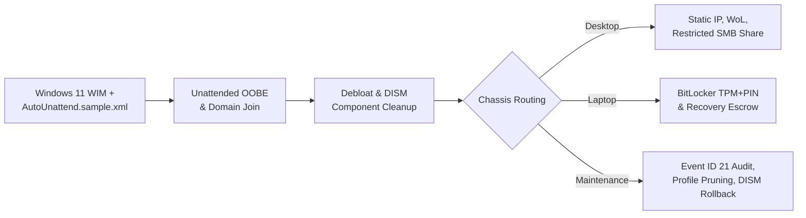

# Windows Endpoint Automation & Runbook Toolkit

A sanitized, production-inspired collection of **PowerShell 5.1+ automation scripts**, **Windows 11 unattended provisioning templates**, and **multi-site infrastructure runbooks** designed for RMM-driven fleet management, security hardening, and Layer 1–3 operational triage.

> **Sanitization Notice:** All scripts, XML templates, JSON mappings, and runbooks in this repository are generalized reference implementations inspired by real enterprise operations across an 18-site healthcare fleet (500+ endpoints). Zero proprietary domains, internal IP addresses, hostnames, credentials, or organizational data are included.

---

## Architecture Overview

Endpoints deploy through a thin Windows 11 golden image combined with **Object-Oriented Chassis Policy Inheritance**, separating universal OS baselines from Desktop, Laptop, and Specialized Operatory profiles:



---

## Repository Index

### 1. Provisioning & Configuration (`provisioning/`)
| File | Purpose |
| :--- | :--- |
| [`AutoUnattend.sample.xml`](provisioning/AutoUnattend.sample.xml) | Unattended Windows 11 OOBE bypass, domain join, local account baseline, and 2-cycle auto-logon for RMM script settlement. |
| [`Invoke-WindowsDebloat.ps1`](provisioning/Invoke-WindowsDebloat.ps1) | Removes provisioned and per-user consumer AppX packages, optionally uninstalls OneDrive, and runs `DISM /StartComponentCleanup`. |
| [`Set-LocationStaticIP.ps1`](provisioning/Set-LocationStaticIP.ps1) | Reads site subnet/gateway definitions from [`config/sites.sample.json`](config/sites.sample.json) to configure static IPv4/DNS while aborting on active Wi-Fi conflicts. |
| [`Rename-EndpointBySite.ps1`](provisioning/Rename-EndpointBySite.ps1) | Enforces `<SITE>-<DEV>-<ASSET>` naming standards, flushes cached SMB locks, and executes domain-joined `Rename-Computer`. |

### 2. Security, Encryption & Patching (`security-and-patching/`)
| File | Purpose |
| :--- | :--- |
| [`Enable-BitLockerWithEscrow.ps1`](security-and-patching/Enable-BitLockerWithEscrow.ps1) | Generates BitLocker recovery protectors, backs up and timestamp-archives serial-keyed recovery files to a network share, and enables TPM+PIN. |
| [`Invoke-BitLockerUpdateWindow.ps1`](security-and-patching/Invoke-BitLockerUpdateWindow.ps1) | Chassis-aware BitLocker management (`-Phase PreUpdate \| PostUpdate`) verifying AC power before suspending BitLocker for BIOS/firmware updates. |
| [`New-RestrictedScanSmbShare.ps1`](security-and-patching/New-RestrictedScanSmbShare.ps1) | Provisions local scan-to-desktop SMB shares with inheritance stripped, `Domain Admins` ownership, explicit `Modify` ACLs, and zero `Everyone` access. |
| [`Uninstall-WindowsCumulativeUpdate.ps1`](security-and-patching/Uninstall-WindowsCumulativeUpdate.ps1) | Safely isolates CBS `RollupFix` packages by KB number (excluding core OS components) for clean `DISM /Remove-Package` rollbacks. |

### 3. Fleet Maintenance & Diagnostics (`fleet-maintenance/`)
| File | Purpose |
| :--- | :--- |
| [`Set-DellWakeOnLan.ps1`](fleet-maintenance/Set-DellWakeOnLan.ps1) | Synchronizes 802.3 NIC wake properties with Dell UEFI/BIOS ACPI settings via `DellBIOSProvider` (`-Mode Enable \| Disable`). |
| [`Get-InteractiveLogonAudit.ps1`](fleet-maintenance/Get-InteractiveLogonAudit.ps1) | Parses `TerminalServices-LocalSessionManager/Operational` Event ID 21 logs to report true latest interactive user logons. |
| [`Clear-StaleUserProfiles.ps1`](fleet-maintenance/Clear-StaleUserProfiles.ps1) | Combines Event ID 21 activity whitelisting with `Win32_UserProfile` cleanup (safe simulation by default; requires `-ExecuteDeletion`). |

### 4. Engineering Runbooks & Standards (`docs/`)
- [`architecture-policy-inheritance.md`](docs/architecture-policy-inheritance.md) — Policy inheritance provisioning model and hardware lifecycle design.
- [`powershell-rmm-standards.md`](docs/powershell-rmm-standards.md) — RMM `SYSTEM` context standards, exit codes, `curl.exe` REST API alias pitfall, and SMB double-hop prevention.
- [`dual-wan-failover-rca.md`](docs/dual-wan-failover-rca.md) — Root-cause analysis of physical link-state vs. logical probes and stateful NAT failover drops.
- [`vlan-switchport-triage-runbook.md`](docs/vlan-switchport-triage-runbook.md) — Layer 1/Layer 2 VLAN switchport mismatch workflow using SNMP tracing and MDF physical toning.
- [`appx-debloat-catalog.md`](docs/appx-debloat-catalog.md) — Reference matrix of Windows 11 AppX debloat candidates.

---

## Quick Usage Examples

All scripts target **PowerShell 5.1+** with Administrator / `SYSTEM` privileges and support `-WhatIf` on state-changing operations:

```powershell
# Dry-run profile cleanup for accounts inactive > 30 days
.\fleet-maintenance\Clear-StaleUserProfiles.ps1 -RetentionDays 30

# Preview AppX debloat without making changes
.\provisioning\Invoke-WindowsDebloat.ps1 -WhatIf

# Configure static IP from sample multi-site JSON config
.\provisioning\Set-LocationStaticIP.ps1 -SiteName "Site-North" -HostOctet 45 -ConfigPath ".\config\sites.sample.json"

# Suspend BitLocker safely before firmware updates on laptops
.\security-and-patching\Invoke-BitLockerUpdateWindow.ps1 -Phase PreUpdate -RebootCount 5
```

---

## Author

**Ivan Alier-Reyes**  
Systems & Endpoint Automation Specialist | CompTIA Security+ | Cisco CCNA *(In Progress)*  
- Portfolio: [WillofHuitzil.com](https://willofhuitzil.com)
- LinkedIn: [linkedin.com/in/ivan-alier-reyes](https://linkedin.com/in/ivan-alier-reyes)
- GitHub: [github.com/Dr-Huitzil](https://github.com/Dr-Huitzil)
