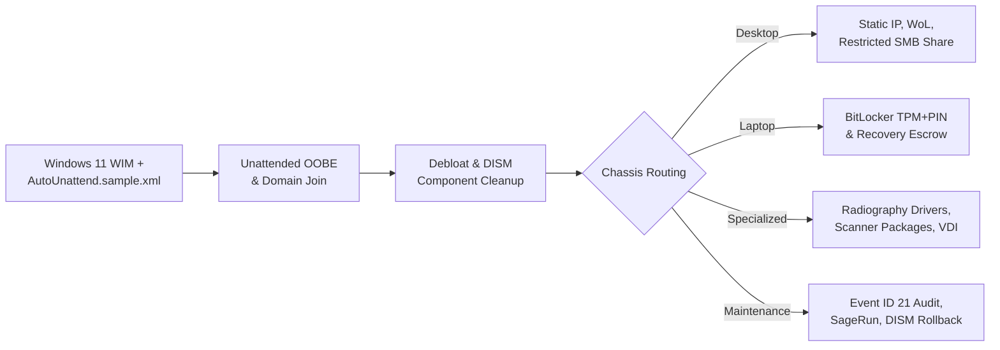

# Windows Endpoint Automation & Runbook Toolkit

A sanitized, production-grade collection of **43+ PowerShell 5.1+ automation scripts**, **Windows 11 unattended provisioning templates**, and **multi-site infrastructure runbooks** designed for enterprise RMM-driven fleet management (NinjaOne, Intune, Datto), endpoint security hardening, and Layer 1–3 operational triage.

> **Sanitization Notice:** All scripts, XML templates, JSON mappings, and runbooks in this repository are generalized reference implementations inspired by real enterprise operations across an 18-site healthcare fleet (500+ endpoints). Zero proprietary domains, internal IP addresses, hostnames, credentials, or organizational patient data are included.

---

## Dual-Mode Architecture: NinjaOne RMM Pop-ups & CLI Automation

Every script in this repository is built with **Dual-Binding Parameter Architecture**. They function natively inside **NinjaOne RMM script library form modals** while remaining 100% executable and testable as standalone tools via standard PowerShell CLI:

```powershell
[CmdletBinding(SupportsShouldProcess = $true)]
param(
    # Binds automatically to NinjaOne modal pop-up inputs ($env:location), or accepts standard CLI arguments
    [Parameter(Mandatory = $false, HelpMessage = "Site or clinic location code")]
    [string]$Location = $env:location,

    [Parameter(Mandatory = $false, HelpMessage = "Device chassis type (Desktop/Laptop)")]
    [ValidateSet("Desktop", "Laptop")]
    [string]$DeviceType = $env:deviceType,

    [Parameter(Mandatory = $false, HelpMessage = "Sequential asset tag number")]
    [string]$AssetNumber = $env:assetNumber
)
```

- **In NinjaOne RMM:** When a technician clicks **Run Script**, Ninja presents input fields (dropdowns, text inputs, secure passwords). Upon submission, Ninja sets `$env:<variable>`, which PowerShell binds to parameters automatically.
- **In CLI / CI-CD / Standalone:** Technicians or automated pipelines pass arguments directly (`.\script.ps1 -Location "Site-A" -DeviceType "Laptop" -AssetNumber "1042"`).

---

## Fleet Provisioning & Chassis Routing Model

Endpoints deploy through a thin Windows 11 golden image combined with **Object-Oriented Chassis Policy Inheritance**, separating universal OS baselines from Desktop, Laptop, and Specialized Operatory profiles:



---

## Complete Repository Index (43+ Scripts)

### 1. Provisioning & Chassis Baselines (`provisioning/`)
| File | Purpose | Key Parameters / Inputs |
| :--- | :--- | :--- |
| [`AutoUnattend.sample.xml`](provisioning/AutoUnattend.sample.xml) | Unattended Windows 11 OOBE bypass, domain join, local account baseline, and 2-cycle auto-logon for RMM script settlement. | XML Answer File |
| [`Invoke-WindowsDebloat.ps1`](provisioning/Invoke-WindowsDebloat.ps1) | Removes provisioned and per-user consumer AppX packages, removes OneDrive, and runs `DISM /StartComponentCleanup`. | `-WhatIf`, `-RemoveOneDrive` |
| [`Rename-EndpointBySite.ps1`](provisioning/Rename-EndpointBySite.ps1) | Enforces `<SITE>-<DEV>-<ASSET>` naming standards, flushes SMB locks, and executes domain-joined `Rename-Computer`. | `$env:location`, `$env:deviceType`, `$env:assetNumber` |
| [`Set-LocationStaticIP.ps1`](provisioning/Set-LocationStaticIP.ps1) | Reads site subnet/gateway definitions from JSON configuration to assign static IPv4/DNS while aborting on active Wi-Fi. | `$env:location`, `$env:octet`, `-ConfigPath` |
| [`Set-EndpointStaticIP.ps1`](provisioning/Set-EndpointStaticIP.ps1) | Directly configures static IP, subnet mask, gateway, and primary/secondary DNS servers on active Ethernet NICs. | `$env:ipAddress`, `$env:prefixLength`, `$env:gateway`, `$env:dns1` |
| [`Set-LaptopLidPowerPolicy.ps1`](provisioning/Set-LaptopLidPowerPolicy.ps1) | Configures AC and DC lid-close power policies to "Do Nothing" for docked clinical laptops via `powercfg`. | `$env:lidAction` (`DoNothing` \| `Sleep`) |
| [`Disable-AdapterPowerManagement.ps1`](provisioning/Disable-AdapterPowerManagement.ps1) | Disables selective power-saving suspension on Wi-Fi NICs (e.g. Realtek RTL8852BE) to eliminate wireless drops. | `$env:interfacePattern` |
| [`Register-WindowsProductKey.ps1`](provisioning/Register-WindowsProductKey.ps1) | Extracts embedded OEM product keys from UEFI firmware ACPI tables and activates Windows online via `slmgr.vbs`. | `$env:productKey` (Optional override) |
| [`New-PublicDesktopShortcut.ps1`](provisioning/New-PublicDesktopShortcut.ps1) | Provisions standardized `.url` internet shortcuts on the Public Desktop for all clinical users. | `$env:shortcutName`, `$env:targetUrl` |

### 2. Security, Encryption & Identity (`security-and-patching/`)
| File | Purpose | Key Parameters / Inputs |
| :--- | :--- | :--- |
| [`Enable-BitLockerWithEscrow.ps1`](security-and-patching/Enable-BitLockerWithEscrow.ps1) | Generates BitLocker recovery protectors, backs up serial-keyed recovery files to network shares, and enables TPM+PIN. | `-MountPoint`, `-NetworkBackupShare` |
| [`Invoke-BitLockerUpdateWindow.ps1`](security-and-patching/Invoke-BitLockerUpdateWindow.ps1) | Chassis-aware BitLocker management verifying AC power before suspending BitLocker for BIOS/firmware updates. | `-Phase` (`PreUpdate` \| `PostUpdate`), `-RebootCount` |
| [`New-RestrictedScanSmbShare.ps1`](security-and-patching/New-RestrictedScanSmbShare.ps1) | Provisions local scan-to-desktop SMB shares with inheritance stripped, Domain Admins ownership, and explicit user ACLs. | `$env:adUsername`, `-ShareName` |
| [`Uninstall-WindowsCumulativeUpdate.ps1`](security-and-patching/Uninstall-WindowsCumulativeUpdate.ps1) | Safely isolates CBS `RollupFix` packages by KB number (excluding core OS components) for clean DISM package rollbacks. | `-KBNumber`, `-WhatIf` |
| [`Initialize-StandardLocalAccounts.ps1`](security-and-patching/Initialize-StandardLocalAccounts.ps1) | Standardizes local SAM accounts, enforcing non-expiring passwords and restricting user password modification. | `$env:localUsername`, `$env:localPassword`, `$env:accountRole` |
| [`Set-LocalAccountPassword.ps1`](security-and-patching/Set-LocalAccountPassword.ps1) | Safely updates local passwords for specified local user or administrator accounts via SecureString. | `$env:account` (`User` \| `Administrator`), `$env:password` |
| [`Remove-LocalUserProfile.ps1`](security-and-patching/Remove-LocalUserProfile.ps1) | Completely deprovisions target local user accounts, removing SAM objects, disk profiles, and registry ProfileList SIDs. | `$env:targetUsername` |
| [`Move-ComputerActiveDirectoryOU.ps1`](security-and-patching/Move-ComputerActiveDirectoryOU.ps1) | Uses native `[ADSISearcher]` to locate and move the computer object in Active Directory and force `gpupdate` (Zero RSAT needed). | `$env:targetOUPath` |

### 3. Fleet Maintenance & Windows Updates (`fleet-maintenance/`)
| File | Purpose | Key Parameters / Inputs |
| :--- | :--- | :--- |
| [`Clear-StaleUserProfiles.ps1`](fleet-maintenance/Clear-StaleUserProfiles.ps1) | Combines Event ID 21 activity whitelisting with `Win32_UserProfile` cleanup (safe simulation by default). | `-RetentionDays`, `-ExecuteDeletion` |
| [`Get-InteractiveLogonAudit.ps1`](fleet-maintenance/Get-InteractiveLogonAudit.ps1) | Parses `TerminalServices-LocalSessionManager/Operational` Event ID 21 logs to report true interactive user logons. | `-LogName`, `-MaxEvents` |
| [`Set-DellWakeOnLan.ps1`](fleet-maintenance/Set-DellWakeOnLan.ps1) | Synchronizes 802.3 NIC wake properties with Dell UEFI/BIOS ACPI settings via `DellBIOSProvider`. | `-Mode` (`Enable` \| `Disable`) |
| [`Invoke-WorkstationDiskCleanup.ps1`](fleet-maintenance/Invoke-WorkstationDiskCleanup.ps1) | Automated SageRun cleanup clearing Recycle Bins, Windows/User Temp, and running cleanmgr (resolves Auvik 80%+ storage alerts). | Calculates & logs GB recovered |
| [`Invoke-DellCommandUpdate.ps1`](fleet-maintenance/Invoke-DellCommandUpdate.ps1) | Automates `dcu-cli.exe` driver, firmware, and BIOS patching with automated BitLocker suspension handling. | `-InstallIfMissing`, `-ApplyUpdates` |
| [`Reset-WindowsUpdateDatabase.ps1`](fleet-maintenance/Reset-WindowsUpdateDatabase.ps1) | Stops wuauserv/bits/cryptsvc, archives `SoftwareDistribution` to force OS database rebuild, and initiates fresh scan. | Automatic service recovery |
| [`Invoke-WindowsUpdateSweep.ps1`](fleet-maintenance/Invoke-WindowsUpdateSweep.ps1) | Bootstraps `PSWindowsUpdate` over TLS 1.2 and installs quality/security patches while filtering disruptive feature upgrades. | `$env:excludeUpdatePattern`, `-AutoReboot` |
| [`Invoke-WingetFleetUpdate.ps1`](fleet-maintenance/Invoke-WingetFleetUpdate.ps1) | Triggers native Windows Store update task under SYSTEM and executes machine-wide Winget application upgrades. | `$env:wingetPackageId` |
| [`Switch-WiFiAdapterState.ps1`](fleet-maintenance/Switch-WiFiAdapterState.ps1) | Toggles wireless network adapters (`Enable` \| `Disable`) to prevent dual-homing routing loops on docked systems. | `$env:adapterState`, `$env:wifiInterfaceName` |
| [`Repair-SystemPathEnvironment.ps1`](fleet-maintenance/Repair-SystemPathEnvironment.ps1) | Verifies and safely appends missing system paths (e.g. 64-bit PowerShell v1.0) to Machine PATH without string truncation. | `$env:targetSystemPath` |

### 4. Application Lifecycle & Silent Uninstallation (`application-lifecycle/`)
| File | Purpose | Key Parameters / Inputs |
| :--- | :--- | :--- |
| [`Install-RemoteMsiPackage.ps1`](application-lifecycle/Install-RemoteMsiPackage.ps1) | Stages MSI installers locally from SMB shares to circumvent Kerberos double-hop delegation blocks under SYSTEM context. | `$env:msiSourcePath`, `$env:msiFileName`, `$env:msiArguments` |
| [`Uninstall-ApplicationByRegistry.ps1`](application-lifecycle/Uninstall-ApplicationByRegistry.ps1) | Registry-driven uninstaller engine scanning 32-bit and 64-bit hives for product name patterns, extracting GUIDs or silent switches. | `$env:appNameMatch` (e.g. "TSPrint") |
| [`Uninstall-DellSupportAssist.ps1`](application-lifecycle/Uninstall-DellSupportAssist.ps1) | Fleet-wide decommission of SupportAssist (terminates background processes, purges AppX packages, and executes quiet MSI uninstalls). | Remediates recurring vendor CVEs |
| [`Uninstall-MozillaFirefox.ps1`](application-lifecycle/Uninstall-MozillaFirefox.ps1) | Silently removes unmanaged Mozilla Firefox installations via `helper.exe /S` to standardize on managed Chrome/Edge. | Silent uninstallation |
| [`Update-GoogleChromeEnterprise.ps1`](application-lifecycle/Update-GoogleChromeEnterprise.ps1) | Releases process locks, downloads the latest standalone enterprise 64-bit MSI from Google CDN, and updates silently. | `-ForceProcessTermination` |
| [`Update-MicrosoftEdgeEnterprise.ps1`](application-lifecycle/Update-MicrosoftEdgeEnterprise.ps1) | Dual-mode Microsoft Edge update engine: triggers machine-wide Winget upgrade with fallback to native EdgeUpdate engine. | Background execution |
| [`Update-VMwareHorizonClient.ps1`](application-lifecycle/Update-VMwareHorizonClient.ps1) | Terminates active Horizon Client sessions, downloads latest vendor installer, and executes unattended `/qn` upgrade. | `$env:vmwareClientUrl` |

### 5. Diagnostics & Auditing (`diagnostics-and-auditing/`)
| File | Purpose | Key Parameters / Inputs |
| :--- | :--- | :--- |
| [`Get-DotNetRuntimeAudit.ps1`](diagnostics-and-auditing/Get-DotNetRuntimeAudit.ps1) | Scans installed application folders for `*.runtimeconfig.json` to inventory .NET Core / .NET Desktop (6/7/8) runtime dependencies. | `-SearchPaths` |
| [`Get-PrintSpoolerDiagnostic.ps1`](diagnostics-and-auditing/Get-PrintSpoolerDiagnostic.ps1) | Correlates System Event ID 7011 timeouts, Application Event ID 1002 hangs, and PrintService error/warning logs over 7 days. | `$env:daysToLookBack` (Default: 7) |
| [`Export-RemotePrinterConfigurationXml.ps1`](diagnostics-and-auditing/Export-RemotePrinterConfigurationXml.ps1) | Bypasses Session 0 isolation via temporary interactive scheduled tasks to extract user-level `PrintTicketXML` configs over WinRM. | `$env:targetComputerName`, `$env:targetPrinterName` |

### 6. Specialized Hardware & Clinical Deployments (`specialized-deployments/`)
| File | Purpose | Key Parameters / Inputs |
| :--- | :--- | :--- |
| [`Install-DentalSensorDrivers.ps1`](specialized-deployments/Install-DentalSensorDrivers.ps1) | Unattended deployment of digital intraoral sensor drivers (GxPicture silent switches + KaVo InstallShield response files). | `$env:sensorDriverSourcePath`, [`setup.sample.iss`](specialized-deployments/setup.sample.iss) |
| [`Install-ImagingSuite.ps1`](specialized-deployments/Install-ImagingSuite.ps1) | Stages clinical radiography suites, chains Visual C++ Redistributable prerequisites, and creates Public Desktop shortcuts. | `$env:imagingSourcePath`, `$env:imagingDestinationPath` |
| [`Install-FujitsuScandAllPro.ps1`](specialized-deployments/Install-FujitsuScandAllPro.ps1) | Stages and silently installs Fujitsu ScandAll PRO for fi-7160/fi-7180 production scanners with verbose MSI logging. | `$env:scandallSourcePath`, `$env:scandallDestinationPath` |
| [`Deploy-RemoteExecuteStartupService.ps1`](specialized-deployments/Deploy-RemoteExecuteStartupService.ps1) | Deploys background service helpers and hidden configuration files to the common Startup folder. | `$env:remoteExecuteSourcePath`, `$env:serviceExeName` |
| [`Restart-AcquisitionSensorService.ps1`](specialized-deployments/Restart-AcquisitionSensorService.ps1) | Recycles digital radiography sensor tray services (`gxstop.exe` -> USB/COM buffer release -> `gxstart.exe`) to recover stuck acquisitions. | `$env:sensorToolsDir` |
| [`Uninstall-LegacySensorUtility.ps1`](specialized-deployments/Uninstall-LegacySensorUtility.ps1) | Silently removes obsolete sensor tray utilities (e.g. DEXIS Connect) via MSI GUID to eliminate driver collisions. | `$env:targetProductGuid` |

### 7. Automated Syntax Validator (`tooling/`)
| File | Purpose |
| :--- | :--- |
| [`Test-ScriptSyntaxAST.ps1`](tooling/Test-ScriptSyntaxAST.ps1) | Uses the .NET `[System.Management.Automation.Language.Parser]` Abstract Syntax Tree (AST) engine to validate every PowerShell script in the repository for syntax, grammatical errors, and unclosed tokens before deployment. |

### 8. Engineering Runbooks & Standards (`docs/`)
- [`architecture-policy-inheritance.md`](docs/architecture-policy-inheritance.md) — Policy inheritance provisioning model and hardware lifecycle design.
- [`powershell-rmm-standards.md`](docs/powershell-rmm-standards.md) — RMM `SYSTEM` context standards, exit codes, `curl.exe` REST API alias pitfall, and SMB double-hop prevention.
- [`dual-wan-failover-rca.md`](docs/dual-wan-failover-rca.md) — Root-cause analysis of physical link-state vs. logical probes and stateful NAT failover drops.
- [`vlan-switchport-triage-runbook.md`](docs/vlan-switchport-triage-runbook.md) — Layer 1/Layer 2 VLAN switchport mismatch workflow using SNMP tracing and MDF physical toning.
- [`appx-debloat-catalog.md`](docs/appx-debloat-catalog.md) — Reference matrix of Windows 11 AppX debloat candidates.

---

## Pre-Deployment Verification

All scripts are validated using the included .NET Abstract Syntax Tree (AST) parser:

```powershell
# Validate all repository scripts
.\tooling\Test-ScriptSyntaxAST.ps1

# Output:
# ====================================================================
# POWERSHELL ABSTRACT SYNTAX TREE (AST) SYNTAX VALIDATOR
# AST VALIDATION COMPLETE: 43 Total Scripts | 0 Failed
# ====================================================================
```

---

## Author

**Ivan Alier-Reyes**  
Systems & Endpoint Automation Specialist | CompTIA Security+ | Cisco CCNA *(In Progress)*  
- Portfolio: [WillofHuitzil.com](https://willofhuitzil.com)
- LinkedIn: [linkedin.com/in/ivan-alier-reyes](https://www.linkedin.com/in/ivan-alier-reyes)
- GitHub: [github.com/Dr-Huitzil](https://github.com/Dr-Huitzil)
