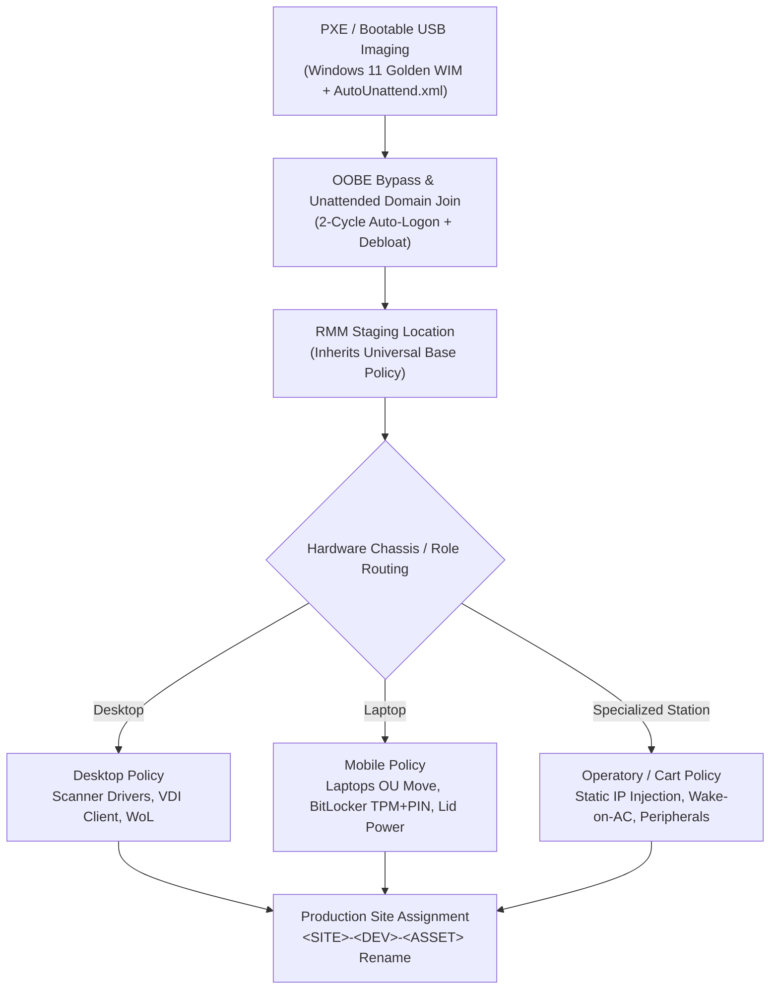

# Object-Oriented Policy Inheritance Provisioning Architecture

Replacing monolithic golden disk images with a layered **Policy Inheritance Engine** keeps OS images thin while allowing automated, hardware-aware provisioning across diverse clinical and enterprise fleets.

---

## Provisioning Flow

---

## Key Architectural Principles

1. **Thin Golden Image + Dynamic Policy Layering:** Only core OS, storage controller validation (`NVMe / AHCI` rather than `RAID ON` during WinPE), and baseline runtime dependencies live inside the WIM. Role-specific drivers and software deploy dynamically from RMM policies.
2. **Two-Cycle Auto-Logon Window:** `AutoUnattend.xml` configures `LogonCount=2` so first-boot AppX debloating (`Invoke-WindowsDebloat.ps1`), OEM driver/BIOS pulls, and initial RMM payloads complete unattended before end-user handover.
3. **Staging-to-Production Separation:** Devices enroll into an isolated staging location during imaging, execute chassis-specific hardening (e.g., AD OU migration before BitLocker escrow), and are renamed/reassigned to their physical site (`<SITE>-<DEV>-<ASSET>`) at deployment.
4. **Automated Lifecycle Decommissioning:** Retired endpoints follow an explicit reverse pipeline—AD disable + `Decommissioned` OU move, RMM/EDR agent removal, multi-seat M365 license release, and physical SSD removal/destruction before e-waste disposal.
